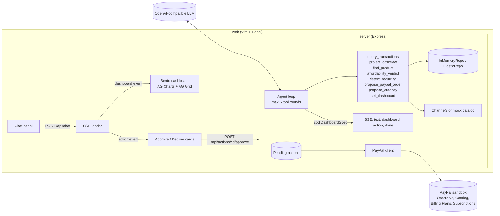

# Pilot: an AI CFO that decides, then acts

> Ask your money a question. Get a decision, a dashboard, and a PayPal action.

Pilot is a chat-driven financial agent for single-income households and gig workers. Ask "Can I afford a PS5?" and Pilot projects your cash flow to month end, returns **Yes / Wait / No** with the math, reshapes a live dashboard around the answer, and drafts a PayPal sandbox order that only goes through when you approve it.

Built for the [PayPal AI Hackathon](https://paypalaihackathon.devpost.com/).

**Demo video:** _YouTube link_ · **Live demo:** _Render URL (optional)_ · **License:** [MIT](LICENSE)

## Run it

**Requirements:** Node.js 20 or newer (includes npm). Works on Windows, macOS and Linux. No accounts or API keys are needed for the first run.

```bash
git clone <this repo>
cd <repo folder>
npm install
npm run dev
```

Open **http://localhost:5173**. The API runs on http://localhost:8787 (check http://localhost:8787/api/health).

Without a `.env` file Pilot runs fully on seed data: 12 months of fictional transactions, a scripted agent that calls the same tools as the LLM, a mock product catalog, and PayPal in **simulate** mode (nothing is sent to PayPal). The top bar shows a **demo data** badge; hover it to see which services are mocked.

To use real services, copy `.env.example` to `.env` and fill in only what you have (see [Environment](#environment)). Every key is optional and the server must be restarted after editing `.env`.

| Command | What it does |
| --- | --- |
| `npm run dev` | API (port 8787, auto-reload) and web app (port 5173) together |
| `npm test` | Automated tests: webhook mapping and dedup, order/subscription lifecycle, simulator, transaction import |
| `npm run typecheck` | TypeScript strict check of server and web |
| `npm run build --workspace=web` / `--workspace=server` | Production builds (`web/dist`, `server/dist`) |
| `npm run paypal:webhooks -- list` | List the sandbox app's webhooks (sandbox mode only) |

## Test it

### 1. Five-minute walkthrough (no keys)

Use the suggestion chips or type these in the chat. Each answer rebuilds the dashboard on the right.

| Ask | You should see |
| --- | --- |
| *Can I afford a PS5?* | A **No** verdict with five reasons, KPI tiles, and a cash-flow timeline dipping under the dashed safety line. A PayPal order card appears in the chat. |
| *How much did I spend on food in the last 6 months?* | KPI tiles with sparklines, spend stacked by month, a split donut and a transactions grid. In the grid, try **Group by → Merchant** and **Pivot**. |
| *Project my expenses for this month* | Month-end timeline with each upcoming bill as a marker; hover it for daily balances. |
| *Find bills I should autopay* | Recurring payments, the electricity bill history, and an autopay proposal for City Electric Co. |
| *Can I afford a $300 jacket?* | Works for items outside the catalog, using the price you typed. |

Then test the PayPal flow (simulated):

1. On the autopay card, click **Approve autopay**. The card shows *Waiting for the subscriber to approve*, and about 3 seconds later *Autopay active*, labelled **simulated** (a simulated `BILLING.SUBSCRIPTION.ACTIVATED` webhook).
2. On the PS5 order card, click **Pay $999.99 with PayPal**. It moves to *Buyer approved, ready to capture* after about 3 seconds; click **Capture payment** to finish (*Payment captured*).
3. Click **Decline** on any other proposal: nothing is sent and the buttons lock.

The light/dark toggle is in the top-right corner; below 900px wide the chat becomes a drawer (open it with the round button).

### 2. With a real LLM

Add any OpenAI-compatible endpoint with tool calling to `.env`, for example:

```bash
LLM_BASE_URL=https://openrouter.ai/api/v1   # or https://api.groq.com/openai/v1, https://api.openai.com/v1
LLM_API_KEY=<your key>
LLM_MODEL=openai/gpt-4o-mini                 # any tool-calling model on that endpoint
```

Restart `npm run dev`; `/api/health` now reports `"llm": "configured"`. Ask free-form questions ("What are my three biggest expenses?", "Should I wait until payday to buy a $450 console?"). If a call fails or times out, that turn is answered by the scripted agent and health shows `"llm": "fallback"`.

### 3. With the PayPal sandbox

1. Sign in at [developer.paypal.com](https://developer.paypal.com/dashboard/applications/sandbox) (any PayPal account works). Under **Testing Tools → Sandbox Accounts**, use (or create) a **Business** and a **Personal** account with country **United States**: Pilot charges in USD, and accounts registered in some countries (for example India) are refused with *"This seller doesn't accept payments in your currency"*. Then create a sandbox REST app under **Apps & Credentials → Sandbox** for the US business account.
2. In `.env`: `PAYPAL_MODE=sandbox`, `PAYPAL_CLIENT_ID=…`, `PAYPAL_CLIENT_SECRET=…`. Restart. Health shows `"paypal": "sandbox"`.
3. Ask *Can I afford a PS5?*, click **Pay with PayPal**, then **Complete in PayPal sandbox**. PayPal opens in a popup: log in with the sandbox **personal** account (its email and password are under **Testing Tools → Sandbox Accounts → … → View/Edit account**; the business account cannot pay itself) and approve. The popup closes itself and your Pilot tab keeps its conversation.
4. Back in Pilot the card switches to *Buyer approved* within seconds (the popup reports back, plus a webhook if configured, or the 5s poll). Click **Capture payment**. The purchase is added to your transactions and taken off the balance straight away, and is kept across restarts (see [Data and persistence](#data-and-persistence)).
5. Optional: webhooks and live transactions, see [PayPal sandbox: status updates, webhooks and live data](#paypal-sandbox-status-updates-webhooks-and-live-data).

The sandbox keeps everything you create permanently (orders expire after 3 hours if not approved); `simulate` mode sends nothing.

### 4. API and Postman

Import [`postman/pilot.postman_collection.json`](postman/pilot.postman_collection.json) (`baseUrl` = `http://localhost:8787`). Run **Chat: Can I afford a PS5?**, copy the `id` from the `action` event into the `actionId` variable, then **Approve action**, **Action status** and **Capture order**. Or with curl:

```bash
curl http://localhost:8787/api/health
curl -N -X POST http://localhost:8787/api/chat -H "Content-Type: application/json" \
  -d '{"messages":[{"role":"user","content":"Can I afford a PS5?"}]}'
curl -X POST http://localhost:8787/api/actions/<actionId>/approve
curl http://localhost:8787/api/actions/<actionId>/status
curl -N http://localhost:8787/api/events          # live status stream
```

### Troubleshooting

| Problem | Fix |
| --- | --- |
| `Port 8787` or `5173` already in use | Stop the other process, or set `PORT=` in `.env` (API) |
| Dashboard shows "Can't reach the server" | The API isn't running: check the `[server]` lines in the `npm run dev` output |
| Changed `.env` but nothing happened | Restart `npm run dev`; `.env` is read at startup |
| `"liveTransactions": "error"` in health | Enable **Transaction search** on the sandbox app (Features), or set `PAYPAL_SYNC_TRANSACTIONS=false` |
| PayPal says *"This seller doesn't accept payments in your currency"* | Use US sandbox accounts (see [With the PayPal sandbox](#3-with-the-paypal-sandbox)) |
| The PayPal window didn't open | Allow pop-ups for the Pilot site; Pilot falls back to a new tab, which closes itself after approval |
| Capture says the order is not approved | Approve it in the PayPal sandbox window first; this is PayPal's real `ORDER_NOT_APPROVED` response |

## Features

1. **Affordability verdict.** Finds the product and price (Channel3 or a mock catalog), projects balance to month end from balance, upcoming bills and your 90-day spending rate, then applies a clear rule: **No** if the projected month-end balance after the purchase is under 15% of monthly income, **Wait** if under 30% (or the purchase is large against a single income), otherwise **Yes**. Approving creates a PayPal sandbox order. You can override a No.
2. **Autopay advisor.** Detects recurring payments and proposes moving one (the electricity bill) to a PayPal subscription: catalog product, then billing plan, then subscription. Nothing is created until you click Approve.
3. **Generative dashboard.** 30% chat, 70% dashboard. The agent calls `set_dashboard` with a JSON `DashboardSpec` (KPI, chart, grid, timeline and verdict widgets). The server validates it with zod, asks the model to fix it once if invalid, and falls back to a default dashboard after that. The web app animates old widgets out and new ones in.

## Environment

| Variable | Purpose | Without it |
| --- | --- | --- |
| `LLM_BASE_URL`, `LLM_API_KEY`, `LLM_MODEL` | Any OpenAI-compatible chat completions endpoint with tool calling (OpenRouter, Groq, Gemini OpenAI-compatible, OpenAI) | Deterministic scripted agent that calls the same tools |
| `PAYPAL_MODE` | `simulate` (default): nothing is sent to PayPal. `sandbox`: opt-in real sandbox calls (also needs the credentials). The sandbox permanently keeps products, plans, subscriptions and captured payments (none can be deleted; plans can only be deactivated, subscriptions cancelled; unapproved orders expire after 3h) | `simulate` |
| `PAYPAL_CLIENT_ID`, `PAYPAL_CLIENT_SECRET` | PayPal sandbox REST app, used only when `PAYPAL_MODE=sandbox` | Simulated order and subscription IDs, labelled "simulated" |
| `PAYPAL_BASE_URL` | Defaults to `https://api-m.sandbox.paypal.com` | |
| `APP_URL` | Where PayPal redirects after approval | `http://localhost:5173` |
| `ELASTIC_URL`, `ELASTIC_API_KEY` | Index the transactions in Elastic on startup (key optional for a local cluster) | In-memory store |
| `CHANNEL3_API_KEY` | Live product and price search | Mock catalog |
| `PAYPAL_WEBHOOK_ID` | Id of the sandbox app's webhook (created with `npm run paypal:webhooks -- create <url>`). Every delivery is verified with PayPal against it | Webhooks rejected; live status comes from polling |
| `PAYPAL_SYNC_TRANSACTIONS` | In sandbox mode, on every start (and every 10 min) Pilot loads the sandbox account's last 31 days of activity and its live USD balance. Set `false` to turn it off. Needs **Transaction search** enabled on the app | On in sandbox mode; seed data in simulate mode |
| `DATA_DIR` | Where the state file is written (`state.json`) | `server/.data` |
| `PAYPAL_SIMULATED_APPROVAL_MS` | Simulate mode: delay before the simulated buyer-approval webhook | `3000` |
| `PORT` | API port | `8787` |
| `VITE_API_URL` | API origin for a deployed web build | Vite dev proxy to `/api` |

Every service falls back to seed data instead of failing: if the LLM call fails, times out (30s) or returns no usable dashboard, at any point in the tool loop, the scripted agent finishes that turn; Channel3 errors, timeouts (5s) or unpriced results fall back to the mock catalog, and unknown items get a seeded typical price (or the price you typed, e.g. "a $300 jacket"); Elastic failures keep the in-memory store; PayPal errors return simulated ids labelled "simulated". `/api/health` reports what is actually live (`fallback` means configured but currently failing) and the PayPal mode.

With `PAYPAL_MODE=sandbox`, capturing an order the buyer has not approved yet returns `{ "status": "NOT_APPROVED", "demo": false }` (never a fake success); approve it at the link first.

## PayPal sandbox: status updates, webhooks and live data

Pilot runs the same PayPal lifecycle in both modes, so reviewers can check it without a PayPal account and then switch to a real sandbox app.

| | `PAYPAL_MODE=simulate` (default, seed data) | `PAYPAL_MODE=sandbox` (live) |
| --- | --- | --- |
| Create order / subscription | `DEMO-*` ids, nothing sent to PayPal | Orders v2, Catalog Products, Billing Plans, Subscriptions |
| Status updates | Simulated webhooks in PayPal's event shape (`CHECKOUT.ORDER.APPROVED` after 3s, `PAYMENT.CAPTURE.COMPLETED`, `BILLING.SUBSCRIPTION.ACTIVATED`, ...) | Signature-verified webhooks at `POST /api/paypal/webhook`, plus live polling of `GET /v2/checkout/orders/{id}` and `GET /v1/billing/subscriptions/{id}` |
| Transactions and balance | 12 months of seed data, $2,000 balance | Seed data plus the sandbox account's real activity, and its live balance, loaded on every start |

Both paths go through one `WebhookProcessor` (dedup by event id, maps the event to the order or subscription Pilot created) and are pushed to every open tab over `GET /api/events` (Server-Sent Events). Each PayPal card shows its status history and where each step came from: *verified webhook*, *live from PayPal*, *PayPal API* or *simulated webhook*.

**Connect a sandbox app**

1. In the [PayPal Developer Dashboard](https://developer.paypal.com/dashboard/applications/sandbox), create a sandbox REST app. Put its client id and secret in `.env` and set `PAYPAL_MODE=sandbox`.
2. For live data: under the app's **Features**, enable **Transaction search** (it covers both Transaction Search and the Balances API). New sandbox transactions can take up to 3 hours to appear there; payments made in Pilot show up immediately because Pilot records them at capture.
3. Webhooks need a public https URL. Deploy the API (see Render below) or tunnel localhost, e.g. `cloudflared tunnel --url http://localhost:8787` or `ngrok http 8787`. Register it and copy the printed id into `PAYPAL_WEBHOOK_ID`:
   ```bash
   npm run paypal:webhooks -- create https://<public-host>/api/paypal/webhook
   npm run paypal:webhooks -- list
   ```
4. Restart the server. `/api/health` shows `"paypal": "sandbox"` and `"paypalWebhooks": "verified"`; `GET /api/paypal/status` shows received webhooks and the last sync.
5. Approve a purchase in Pilot, open **Complete in PayPal sandbox** and pay with a sandbox personal account (Developer Dashboard > Testing Tools > Sandbox Accounts). The card moves to *Buyer approved* (webhook, or the next 5s poll), then **Capture payment** completes it.

Without a webhook (for example plain localhost) everything still works: the browser polls the live status every 5 seconds, and when PayPal redirects the approval popup back, the popup tells the server to re-read the status, tells the Pilot tab, and closes. Unverified, forged or replayed webhook deliveries are rejected (401) and never change state.

## Data and persistence

- **On every start** (sandbox mode) the server loads the sandbox account's transactions from the last 31 days and its live balance from PayPal, and refreshes them every 10 minutes. The balance replaces the demo $2,000; `/api/health` shows `"balanceSource": "paypal"` or `"seed"`.
- **While it runs**, every proposal, its PayPal status history, and every payment captured in Pilot is written to `server/.data/state.json` (every 5 seconds when something changed, and on shutdown). A captured payment is added to the transactions and taken off the balance at once, keyed by PayPal's capture id so it isn't counted twice when Transaction Search catches up.
- **After a restart** the server reloads that file, then refreshes from PayPal and continues from there.
- **On Render's free plan** the disk is wiped on every deploy and whenever the service sleeps (about 15 minutes without traffic). The state file then starts empty, and the next start reloads transactions and balance from PayPal; proposals that were still open are gone and need to be asked again. A paid plan with a persistent disk, or a database, would keep them.

## Why there is no login

Pilot is a single-user demo: one fictional household's seed data, plus whatever the connected PayPal sandbox account holds. There is no per-user data to protect, so a login screen with shared demo credentials would add a step for judges without securing anything. The credentials that matter (PayPal client secret, LLM key) stay on the server and are never sent to the browser.

A real multi-user version would need sign-in (for example PayPal's **Log in with PayPal** / OpenID Connect, which also gives each user's own PayPal identity), per-user storage, and per-user PayPal connections.

## Limitations and next steps

| Area | Today | Next step |
| --- | --- | --- |
| Users | Single user, no login (see above) | Log in with PayPal, per-user data |
| Financial data | Generated seed transactions plus the PayPal **sandbox** account's activity and balance. No bank connection | Bank account aggregation with user consent; PayPal live API |
| Balance | Read from the sandbox account that owns the app (the business account), then reduced locally by purchases made in Pilot until the next sync | Read the signed-in user's own balance |
| Storage | One JSON file; on Render's free plan it resets on deploy and after ~15 min idle | A database (for example Render Postgres) |
| Money movement | PayPal **sandbox** only; nothing real is charged | Live credentials and PayPal account review |
| Autopay | Creates a real sandbox subscription, but Pilot doesn't record the recurring charges as transactions until Transaction Search reports them | Record `PAYMENT.SALE.COMPLETED` webhooks as transactions |
| Elastic | Transactions are indexed at startup, queries still run in memory | Move queries to Elastic aggregations |
| Channel3 | Live product search is wired but the endpoint is unconfirmed; the mock catalog answers otherwise | Confirm against Channel3's API docs |
| API hardening | Open CORS, no rate limiting | Restrict to the web origin, add rate limits |
| Advice | Verdicts follow a fixed rule (15% / 30% of income), not personalised financial advice | Disclaimers, user-set safety buffer |
| Hosting | Render free plan sleeps after ~15 min idle; the first request then takes about a minute | Paid instance or keep-alive |

## Architecture



The model never moves money. `propose_*` tools only store a pending action. The PayPal call happens in `/api/actions/:id/approve`, after a human clicks Approve. All secrets stay on the server.

## API

| Method | Path | |
| --- | --- | --- |
| `POST` | `/api/chat` | `{ messages: [{ role, content }] }`, returns an SSE stream: `text`, `dashboard`, `action`, `done` |
| `GET` | `/api/chat/default-dashboard` | Overview dashboard |
| `POST` | `/api/actions/:id/approve` | Creates the PayPal order or subscription; returns ids and the approval link |
| `POST` | `/api/actions/:id/decline` | Marks the action declined |
| `POST` | `/api/actions/:id/capture` | `{ orderId }`, captures an order after buyer approval in the sandbox |
| `GET` | `/api/actions/:id/status` | PayPal status and history; reads PayPal live for sandbox objects |
| `GET` | `/api/events` | SSE stream of PayPal status changes (`status` events) |
| `POST` | `/api/paypal/webhook` | PayPal sandbox webhook receiver (signature verified with `PAYPAL_WEBHOOK_ID`) |
| `POST` | `/api/paypal/simulate` | `{ actionId, eventType }`, plays a PayPal webhook for a simulated order or subscription |
| `POST` | `/api/paypal/return` | `{ token }` or `{ subscription_id }` from PayPal's redirect; refreshes the live status |
| `GET` | `/api/paypal/status` | Mode, webhook wiring (received count, last event) and transaction sync |
| `POST` | `/api/paypal/sync` | Pulls sandbox transactions now (sandbox mode) |
| `GET` | `/api/health` | Which adapters are live vs mocked |

A Postman collection is in [`postman/pilot.postman_collection.json`](postman/pilot.postman_collection.json).

## AI tools used

| Tool | Where | How it is used |
| --- | --- | --- |
| **LLM with tool calling** (any OpenAI-compatible chat completions API; the hosted demo uses `<provider / model>`) | `server/src/agent/loop.ts`, `systemPrompt.ts`, `tools.ts` | The agent. Each chat turn runs a loop of up to 6 tool rounds: the model calls typed tools (`query_transactions`, `project_cashflow`, `find_product`, `affordability_verdict`, `detect_recurring`, `propose_paypal_order`, `propose_autopay`) whose arguments are validated with zod, writes the answer from their results, and designs the dashboard by calling `set_dashboard` with a JSON `DashboardSpec`. The spec is validated, repaired once by the model if invalid, then streamed to the browser. The model can only *propose* PayPal actions; money moves only after the user clicks Approve. |
| **Scripted agent** (no AI, built in) | `server/src/agent/loop.ts` (`runMockAgent`) | Fallback when no LLM key is set or a call fails, so the app always runs. It calls the same tools. `/api/health` shows which one answered (`configured`, `fallback` or `mock`). |
| **Kokoro-82M** (Apache-2.0 text-to-speech, run locally) | Demo video only | Voiceover of the demo video. |

## Sponsors used

| Sponsor | How Pilot uses it |
| --- | --- |
| **PayPal** | Orders v2 (create, approval link, capture) for purchases; Catalog Products, Billing Plans and Subscriptions for autopay (product and plan reused per payee, amount and cadence). OAuth token cached until expiry; every call logged with its status. Simulated by default; set `PAYPAL_MODE=sandbox` with sandbox credentials for real sandbox calls. |
| **AG Grid** | Every table. Themed with the Theming API (`themeQuartz.withParams`), currency formatting, negative amounts in red, category/method pills, and in-code row grouping and pivot by month (built-in grouping and pivot are Enterprise features). |
| **AG Charts** | Bar, line, donut and the cash-flow timeline (area series, bill markers, dashed safety line), with a custom theme so charts match the cards. |
| **Elastic** | Optional store: on startup the transactions are bulk-indexed into `pilot-transactions` with keyword/date mappings. Queries currently run against the in-memory copy because the repository interface is synchronous; moving `query()` to ES aggregations is the next step. |
| **Channel3** | Optional live product and price lookup for the affordability flow. Responses are parsed defensively; check the endpoint in `server/src/agent/tools.ts` (`CHANNEL3_URL`) against your Channel3 account docs. |
| **Render** | `render.yaml` deploys the API as a web service and the web app as a static site. |
| **Postman** | Collection of every endpoint (chat, actions, status, webhooks, simulator, sync), with test scripts that carry the order id into the capture request. |

## Demo script (under 3 minutes)

To demo real PayPal sandbox orders and subscriptions, set `PAYPAL_MODE=sandbox` plus `PAYPAL_CLIENT_ID` / `PAYPAL_CLIENT_SECRET`. Without it, steps 4 and 5 run simulated (labelled "simulated") and nothing reaches PayPal.

1. **"Can I afford a PS5?"** A **No** verdict card appears with the reasoning, and the timeline shows the balance dropping under the safety line.
2. **"How much did I spend on food in the last 6 months?"** The dashboard morphs to KPI tiles, a stacked bar chart and a grid grouped by category.
3. **"Project my expenses for this month."** A cash-flow timeline with upcoming bills appears.
4. **"Find bills I should autopay."** Pilot proposes autopay for City Electric Co. Click **Approve autopay** and the PayPal sandbox subscription is created.
5. Scroll back to the PS5 card and click **Pay with PayPal** (or **Override and buy** on the verdict). The sandbox order is created. Open the approval link, approve with a sandbox buyer, then click **Capture payment**.

## Deploy on Render

1. Push the repo and create a Blueprint from `render.yaml`.
2. Set the secrets on `pilot-api`, and set `APP_URL` to the `pilot-web` URL.
3. Set `VITE_API_URL` on `pilot-web` to the `pilot-api` URL, then redeploy the static site.
4. For live PayPal: set `PAYPAL_MODE=sandbox` and the credentials on `pilot-api`, run `npm run paypal:webhooks -- create https://<pilot-api host>/api/paypal/webhook` locally with the same credentials, and set the printed `PAYPAL_WEBHOOK_ID` on `pilot-api`.

## Project layout

```
server/src
  agent/      system prompt, tool definitions + executor, agent loop, scripted fallback
  paypal/     PayPal REST client (orders, subscriptions, capture, status, webhook verification,
              transaction search), webhook processor, simulator, status events, transaction sync
  routes/     chat (SSE), actions (approve/decline/capture/status), paypal (webhook, simulate, return, sync)
  scripts/    paypalWebhooks.ts: list, create or delete the sandbox app's webhooks
  repo/       IRepo, InMemoryRepo, ElasticRepo
  data/       seed data (12 months, generated from today's date)
  spec.ts     DashboardSpec zod schema (mirrored in web/src/spec.ts)
web/src
  components/ layout (top bar, chat), dashboard, widgets (KPI, chart, grid, timeline, verdict)
  hooks/      useChat (SSE + actions), useDashboard
  lib/        API client, chart/grid themes, formatting
```

## License

MIT
